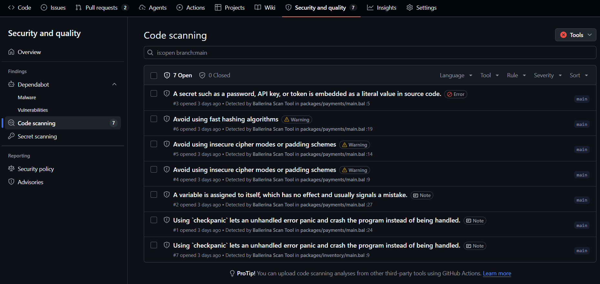
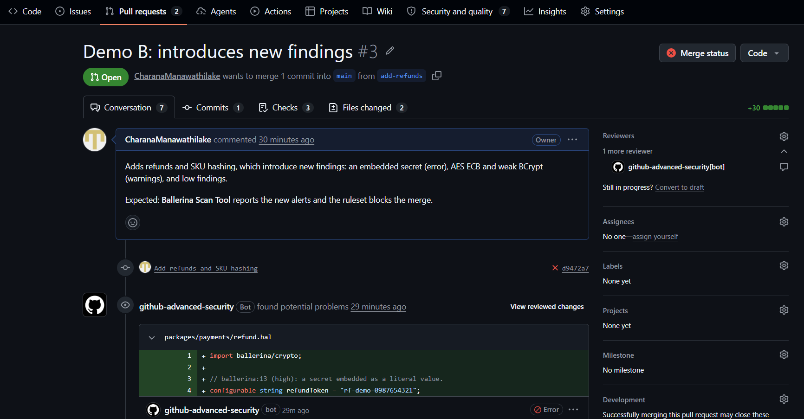
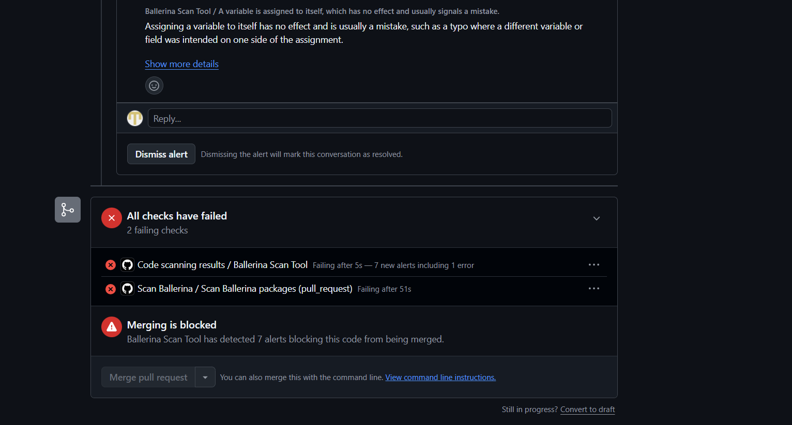
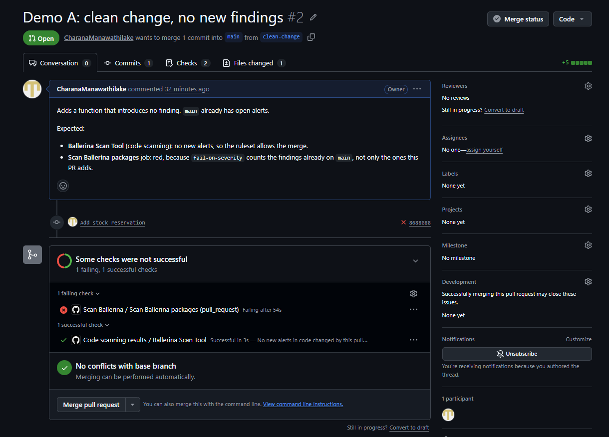
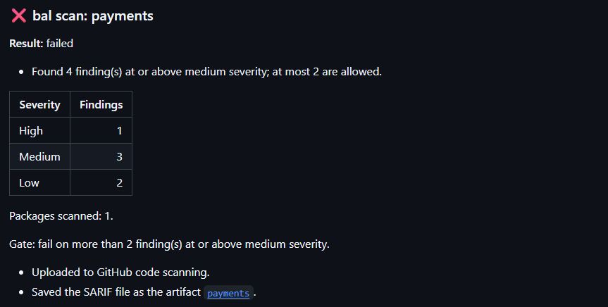
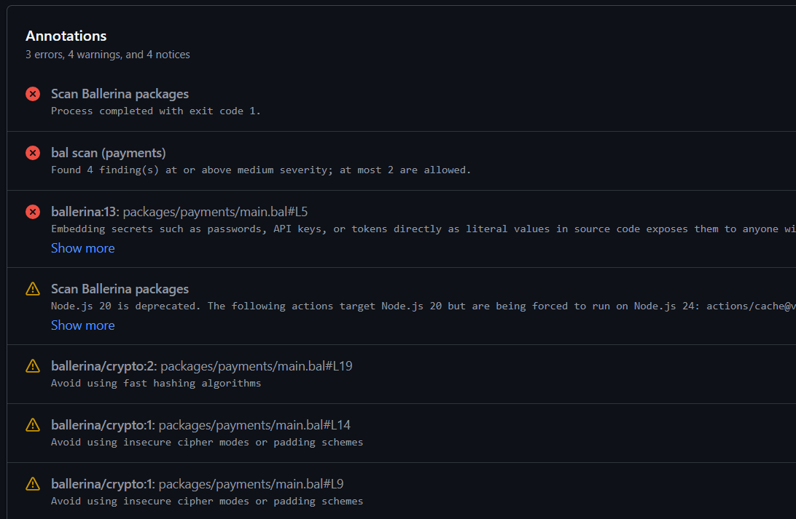

[](https://github.com/ballerina-platform/scan-ballerina/actions/workflows/test.yml)
[](https://github.com/ballerina-platform/scan-ballerina/blob/main/LICENSE)
[](https://github.com/ballerina-platform/scan-ballerina/issues)

# Scan Ballerina

GitHub Action that runs [`bal scan`](https://ballerina.io/learn/scan-tool/) on the Ballerina packages in a repository and sends the findings to the code scanning tool you use: GitHub code scanning, SonarQube, or any other platform that reads SARIF.

The action installs Ballerina and the scan tool, scans every package, and merges the reports into one SARIF 2.1.0 file with paths relative to the repository root. It leaves your files as they were: any file it changes during a scan is restored when that scan ends.

> [!NOTE]
> `v0.1.0` is a pre-release that uses scan tool 0.12.0. The inputs are stable, but `v1` will support scan tool 1.0.0 and later only, so `tool-version` values below 1.0.0 will not work with it. Rule IDs, severities and the findings reported may change with scan tool 1.0.0, so review `include-rules`, `exclude-rules`, `fail-on-severity` and `max-findings` when moving to `v1`.

## Usage

### GitHub code scanning

```yaml
jobs:
  scan:
    runs-on: ubuntu-latest
    permissions:
      contents: read
      security-events: write
      actions: read # Only needed in private repositories
    steps:
      - uses: actions/checkout@v4
      - uses: ballerina-platform/scan-ballerina@v0.1.0
        with:
          platforms: github-code-scanning
```

The findings appear as alerts under **Security and quality > Code scanning**, attributed to the Ballerina Scan Tool:



### SonarQube

The SonarQube server needs the [Ballerina language plugin](https://github.com/ballerina-platform/sonar-ballerina). The action installs the SonarScanner CLI, with its own Java runtime, and the scan tool's SonarQube platform plugin, and passes the server URL, token and project key to the scan:

```yaml
permissions:
  contents: read
  packages: read # The platform plugin is downloaded from GitHub Packages
steps:
  - uses: actions/checkout@v4
    with:
      fetch-depth: 0 # SonarQube needs history for blame and new-code detection
  - uses: ballerina-platform/scan-ballerina@v0.1.0
    with:
      platforms: sonarqube
      platform-config: |
        sonarqube:
          host-url: '${{ vars.SONAR_HOST_URL }}'
          token: '${{ secrets.SONAR_TOKEN }}'
          project-key: my-project
```

Settings left out of `platform-config` are read from the package's `sonar-project.properties`. See [Platform configuration](#platform-configuration).

### Any other SARIF consumer

```yaml
steps:
  - uses: actions/checkout@v4
  - id: scan
    uses: ballerina-platform/scan-ballerina@v0.1.0
  - run: ./upload-to-defectdojo.sh "${{ steps.scan.outputs.sarif-file }}"
```

### Save the SARIF file as an artifact

```yaml
- uses: ballerina-platform/scan-ballerina@v0.1.0
  with:
    artifacts: true
```

The action uploads the merged SARIF file as a workflow artifact named `<category>-<job>`, holding `<category>.sarif`. In a matrix job, the name also ends with the first 8 characters of a hash of the matrix values, as in `bal-scan-scan-1a2b3c4d`, so the jobs of a matrix do not collide. It is the same file as the `sarif-file` output, so saving it takes no extra `bal scan` run.

Artifact names are unique within a workflow run, so give each scan in a job its own `category`. Saving the artifact needs no extra permissions, so it also works in pull requests from forks.

### Gate on findings

```yaml
- uses: ballerina-platform/scan-ballerina@v0.1.0
  with:
    platforms: github-code-scanning
    fail-on-severity: medium # Fail on medium or high findings
    max-findings: 5          # ...when there are more than five of them
```

The findings are uploaded before the gate is applied, so they reach the platforms even when the gate fails.

The gate counts every finding in the scanned packages, not only the ones a pull request introduces, so in a repository that already has findings it fails every pull request until they are fixed. To block only new findings, upload to code scanning and use a [code scanning merge protection rule](https://docs.github.com/en/repositories/configuring-branches-and-merges-in-your-repository/managing-rulesets/available-rules-for-rulesets#set-code-scanning-merge-protection) in a ruleset, which fails a pull request on the alerts it introduces.

In a pull request, code scanning comments on the lines that introduce new alerts:



With the merge protection rule, those alerts block the merge:



A pull request that introduces no alerts passes the code scanning check and can be merged, while a `fail-on-severity` gate still fails it on the findings already on the base branch:



### Job summary and annotations

```yaml
- uses: ballerina-platform/scan-ballerina@v0.1.0
  with:
    platforms: github-code-scanning
    annotations: true
```

The action writes the result, the counts by severity, the gate and where the findings were sent to the job summary:



With `annotations: true`, each counted finding is also shown as a file and line annotation on the run:



### Read the outputs after a failure

Steps after a failed step do not run unless they ask to, so read the outputs from a step with `if: always()` or `if: failure()`:

```yaml
- id: scan
  uses: ballerina-platform/scan-ballerina@v0.1.0
  with:
    platforms: github-code-scanning
    fail-on-severity: high
- if: always()
  env:
    RESULT: ${{ steps.scan.outputs.result }}
    HIGH: ${{ steps.scan.outputs.high-count }}
  run: echo "Result $RESULT, $HIGH high"
```

The action's last inner step runs even when an earlier one failed, so `result` is `error` after a failure before the gate.

## Inputs

| Input | Default | Description |
| --- | --- | --- |
| `ballerina-version` | `latest` | Ballerina version to install. `latest` uses the Ballerina already on the path, if there is one; any other version is installed unless it is the one on the path. Pin a version for reproducible runs. |
| `tool-version` | pinned per release | `bal scan` tool version. |
| `platforms` | empty | Comma separated platforms to send the findings to: `github-code-scanning`, `sonarqube`. Empty produces the SARIF file only. |
| `paths` | `.` | Newline or comma separated paths to scan. Every package and workspace in these paths, including their subdirectories, is scanned, and their findings are merged into one SARIF file. A path that does not exist fails the step. |
| `exclude-paths` | empty | Newline or comma separated globs, relative to the repository root, for packages and files to leave out. A directory excludes everything below it. `*` stays within one directory and `**` crosses directories. |
| `exclude-tests` | `true` | Drop findings in `tests/` and `modules/*/tests/`. |
| `category` | `bal-scan` | Name for this scan. Labels the uploaded findings, the job summary and messages. Use a different one for each scan in a job. |
| `include-rules` | empty | Comma separated rule IDs to report, such as `ballerina:1,ballerina/crypto:1`. Empty reports every rule. |
| `exclude-rules` | empty | Comma separated rule IDs to leave out, such as `ballerina:1,ballerina:10`. Cannot be combined with `include-rules`. |
| `fail-on-severity` | `none` | Fail when findings are at or above `low`, `medium` or `high`. `none` turns the gate off. |
| `max-findings` | `0` | Findings at or above `fail-on-severity` allowed before the step fails. |
| `annotations` | `false` | Show each counted finding as a file and line annotation. GitHub shows at most 10 annotations of each level per step and 50 per job, so beyond that the action annotates the first findings of each severity and warns how many it left out. |
| `job-summary` | `true` | Write the result and the high, medium and low counts to the job summary. |
| `artifacts` | `false` | Save the merged SARIF file as a workflow artifact named after `category` and the job. See [Save the SARIF file as an artifact](#save-the-sarif-file-as-an-artifact). |
| `platform-config` | empty | YAML mapping, keyed by platform, with the settings and credentials each selected platform needs. JSON is accepted. |
| `github-token` | `github.token` | Token for installing Ballerina, downloading the SonarQube platform plugin from GitHub Packages and uploading to code scanning. |

## Platform configuration

`platform-config` holds the settings of every selected platform. Each top-level key is a platform, and its value is that platform's settings. An unknown platform or field fails the step, so a typo such as `tokn` is caught.

```yaml
platform-config: |
  sonarqube:
    host-url: https://sonar.example.com
    token: '${{ secrets.SONAR_TOKEN }}'
    packages:
      - path: services/orders
        project-key: orders
        project-name: Orders Service
      - path: services/payments
        host-url: https://sonar.payments.example.com
        token: '${{ secrets.PAYMENTS_SONAR_TOKEN }}'
        project-key: payments
```

`github-code-scanning` takes no settings.

> [!IMPORTANT]
> GitHub puts each `${{ }}` value into the YAML text before the action parses it, so put secrets in single quotes: a value with `:`, `#` or a leading quote or `{` would otherwise change the YAML or fail to parse. A secret that itself holds a single quote or a line break still does not fit. When `platform-config` does not parse, the action fails without printing the parser's error, which can quote the value.

### `sonarqube`

The fields at the platform level are the defaults for every scanned package. An item under `packages` can set any of them for one package, including its own `host-url` and `token`, so packages in one repository can report to different SonarQube servers or organizations.

| Field | Required | Description |
| --- | --- | --- |
| `plugin-path` | No | Platform plugin JAR, as a path relative to the repository root or an `https` URL. Overrides `path` in `Scan.toml`. Cannot be used with `plugin-version`. |
| `plugin-version` | No | Platform plugin version to download, `0.3.0` or later, or `latest`. Overrides `path` in `Scan.toml`. `latest` warns, since it may not match the pinned scan tool. |
| `properties-file` | No | Properties file, relative to the repository root. Overrides `sonarProjectPropertiesPath` in `Scan.toml`. |
| `host-url` | Yes, unless set under `packages` or in the properties file | SonarQube server URL. Must be `https`. Overrides `sonar.host.url`. |
| `token` | Yes, unless set under `packages` | Token for submitting analyses. Pass it from a secret. |
| `project-key` | Yes, unless set under `packages` or in the properties file | Project key. Overrides `sonar.projectKey`. At the platform level, only when one package is scanned. |
| `project-name` | No | Project name. Overrides `sonar.projectName`. At the platform level, only when one package is scanned. |
| `packages` | No | Per-package settings. Each item has a `path`, relative to the repository root, and any of the fields above. Platform level only. |

Each setting of a package is resolved field by field: its `packages` item, then the platform level, then the package's `Scan.toml` and properties file. Paths in `platform-config` are relative to the repository root, and paths in `Scan.toml` are relative to the package.

- **Platform plugin:** `plugin-path` or `plugin-version`, otherwise the `path` of the `sonarqube` `[[platform]]` entry in `Scan.toml` (a relative path or an `https` URL), otherwise the version this release pins. An absolute path fails, since it points to one machine. A `plugin-path` or `plugin-version` in an item replaces both platform-level fields.
- **Properties file:** `properties-file`, otherwise `sonarProjectPropertiesPath` in `Scan.toml`, otherwise `sonar-project.properties` in the package root, if it exists.
- **Server and token:** an item that sets `host-url` must also set `token`, so a token is never sent to a server it was not configured for. For the same reason, a package that takes its server URL from `sonar.host.url` in its properties file must set its own `token` under `packages`: the platform-level token goes only to a `host-url` in `platform-config`. Every URL must be `https`, including one from the properties file.
- **Project:** each package is a separate SonarQube analysis, so packages on the same server need different project keys. `project-key` and `project-name` at the platform level are for a scan of one package, counted after `exclude-paths`: with more packages they fail, so set them for each package under `packages`. With one package, setting the same field at the platform level and in its item also fails.
- **Workspaces:** SonarQube is not supported for workspaces yet, and a workspace in `paths` fails the step when `sonarqube` is selected. `bal scan` reports each member of a workspace in its own SonarScanner run, all with the one project key of the process, so each member's analysis would replace the previous one. Instead, list the member package directories in `paths`, rather than the workspace or a directory above it, so that the workspace's `Ballerina.toml` is not found. `exclude-paths` does not help here, since excluding the workspace directory also excludes its members. Workspaces are fully supported for the SARIF file.
The platform plugin is published to GitHub Packages, which needs a token with `read:packages` even for public packages. Give the job `packages: read`, or set `plugin-path` to a JAR in the repository or an `https` URL.

The action passes the settings to SonarScanner through the `SONAR_HOST_URL`, `SONAR_TOKEN` and `SONAR_SCANNER_JSON_PARAMS` environment variables of each package's `bal scan` process, never on the command line. SonarScanner gives them precedence over the properties file, and keeps the file's other settings.

Pull requests from forks in `pull_request` runs, and runs triggered by Dependabot on any event other than `pull_request_target` and `workflow_run`, get no secrets and a read-only `GITHUB_TOKEN`. In such a run, the action skips SonarQube with a warning when a token is empty, skips the upload to code scanning with a warning, and still produces the SARIF file. Save it with `artifacts: true` and upload it from a trusted `workflow_run` workflow.

SonarQube receives each package's findings before the `exclude-tests` and `exclude-paths` filters are applied. Use `sonar.exclusions` and `sonar.test.inclusions` to keep the same files out of SonarQube.

## `Scan.toml`

`bal scan` reads each package's settings from `Scan.toml` in the package root, or from the file that `[scan] configPath` in `Ballerina.toml` names. Each workspace member reads its own. The action changes that file during a scan: it hides the `[[platform]]` entries for the SARIF scan, since `bal scan` writes no SARIF report while any is active, and points the `sonarqube` entry to the platform plugin for the SonarQube scan. It then restores the file byte for byte.

When `configPath` is an `https` URL, the action downloads the file once, right after packages are found. A remote file cannot be changed, so for each scan the action writes a changed copy to its work directory and points `configPath` in `Ballerina.toml` to it, then restores `Ballerina.toml` byte for byte. Only a `configPath = "..."` line under the `[scan]` table is changed. `bal scan` reads the copy, so it does not download the file again.

Whatever platforms are selected, the step fails after packages are found, before the tools are downloaded, when a package:

- sets `configPath` to an `http` or other non-`https` URL. The scan tool loads the platform plugin JAR of each `[[platform]]` entry, so the file must not be changed in transit.
- sets `configPath` to an `https` URL that cannot be downloaded, or that is not valid TOML.
- sets `configPath` in a form the action cannot change, such as an inline table. Write it as a `configPath = "..."` line under `[scan]`.
- sets `configPath` to a file that does not exist, which `bal scan` would try to download as a URL.
- has a `[scan]` table without `configPath`, which `bal scan` rejects.

## Outputs

| Output | Description |
| --- | --- |
| `result` | `passed` or `failed` from the gate, `skipped` when no package was found, or `error` when the step failed before the gate. |
| `sarif-file` | The merged, normalized SARIF file. Empty when no package was found or a scan failed. |
| `high-count`, `medium-count`, `low-count`, `total-count` | Counted findings, after the test and path filters. `total-count` does not include `INFO` findings. `0` when no package was found, and empty when the findings were not counted, such as when a scan failed. |
| `packages-scanned` | Number of packages scanned, with each member of a workspace counted. Set once every package was scanned: `0` when no package was found, and empty when a scan failed or did not run. |
| `uploads` | JSON object with one entry per platform the findings were sent to, and an `artifact` entry when the SARIF file was saved as an artifact, such as `{"github-code-scanning": {"sarif-id": "…"}, "sonarqube": [{"package": "…", "project-key": "…", "dashboard-url": "…", "task-id": "…"}], "artifact": {"name": "…", "id": "…", "url": "…"}}`. `{}` when nothing was uploaded. |

Read a value from `uploads` with `fromJSON(steps.scan.outputs.uploads)['github-code-scanning']['sarif-id']`.

## Severity

| Ballerina severity | SARIF `level` | Action severity |
| --- | --- | --- |
| `BLOCKER`, `HIGH` | `error` | `high` |
| `MEDIUM` | `warning` | `medium` |
| `LOW` | `note` | `low` |
| `INFO` | `none` | Not counted |

A result without a `level` takes its rule's default level, and `warning` when the rule has none either.

## Failure behaviour

Findings never fail the step unless you set `fail-on-severity`. Problems with the setup or the scan do.

| Situation | Result |
| --- | --- |
| Invalid input, or a path that does not exist | Fails before packages are searched or anything but `yq` is downloaded |
| Missing or invalid SonarQube settings, missing or duplicate project keys, a `packages` item that matches no package or repeats a path, or a workspace with `sonarqube` | Fails after packages are found, before anything is downloaded |
| No package found | Passes with a warning, result `skipped` |
| `bal scan` fails for a package | The other packages are still scanned, then the step fails without a SARIF file |
| SonarQube is unreachable or rejects the analysis of a package | The other packages are still scanned, the SARIF file is produced and sent to the other platforms, then the step fails with result `error` |
| A package reads its `Scan.toml` from a non-`https` URL, an `https` URL that cannot be downloaded, or a missing file, or has a `[scan]` table without `configPath`, with any platforms | Fails after packages are found, before the tools are downloaded. See [`Scan.toml`](#scantoml) |
| Upload to code scanning fails | Fails, after the SARIF file is written |
| Saving the artifact fails, such as when another scan in the run used the same `category` | Fails, after the findings are uploaded |
| Findings over the gate | Fails, after the SARIF file is written and uploaded |
| Fork or Dependabot pull request with an empty SonarQube token | Skips SonarQube with a warning, and still produces the SARIF file |
| Fork or Dependabot pull request with `github-code-scanning` | Skips the upload with a warning, and keeps the SARIF file as the `sarif-file` output and in the artifact, when `artifacts` is `true` |

## How it works

The action is a composite action. Its logic is in the shell and `jq` scripts in [`scripts/`](scripts), which read their inputs from environment variables and can be run locally:

1. `install-yq.sh` installs `yq` when the runner has no `yq` v4, as on Windows runners. `validate.sh` checks the inputs.
2. `find-packages.sh` finds the packages and workspaces in `paths`, skipping `target`, `build` and `.git`. A workspace is scanned once from its root. It checks each package's `Scan.toml` setting, and downloads a remote `Scan.toml`.
3. `check-sonarqube.sh` resolves each package's SonarQube settings.
4. [`setup-ballerina`](https://github.com/ballerina-platform/setup-ballerina) installs Ballerina, unless `bal` is already on the path and `ballerina-version` is `latest` or the version of that `bal`. On Linux, a Ballerina installed from a `.deb` package is removed first, since `dpkg` cannot install another version over it.
5. `install-scan-tool.sh` installs the scan tool, unless that version is already active. With SonarQube, `install-sonarqube.sh` downloads the platform plugin and the SonarScanner CLI, once per job.
6. `scan.sh` runs `bal scan --format=sarif` on each package, and with SonarQube `bal scan --platforms=sonarqube`.
7. `merge-sarif.sh` normalizes the paths, drops filtered findings and merges the reports into one run.
8. `github/codeql-action/upload-sarif` uploads the SARIF file to code scanning.
9. With `artifacts: true`, `actions/upload-artifact` saves the SARIF file, also when the upload to code scanning failed.
10. `report.sh` writes the annotations and the job summary, and applies the gate.

The scan tool does not write a SARIF report while any `[[platform]]` entry in `Scan.toml` is active. When a package's `Scan.toml` has such entries, `scan.sh` hides them, with their sub-tables, during the SARIF scan only, and restores the file byte for byte as soon as that scan ends, including when it fails.

The action edits `Scan.toml` and `Ballerina.toml` as text, line by line, and reads them with `yq`, which it never uses to write them. An entry runs from its `[[platform]]` header to the next table header that is not one of its sub-tables, so comments, inline tables and spacing elsewhere in the file are kept. After packages are found, the action checks that each edit gives valid TOML without the entries, and fails when it does not, such as for an array of inline tables or a multi-line string holding a line that starts with `[`.

Before changing a file, the action records a copy of it, and the SHA-256 of what it writes, in a journal in the repository's `.git` directory. A trap restores the files when the step is cancelled or fails. When the runner stops the step before the trap runs, such as on a forced cancellation or a timeout, the files stay changed until the next run of the action in the same workspace, which restores each one that still holds what the action wrote. `actions/checkout`, which cleans the workspace by default, also resets them. Without a `.git` directory, the journal is kept in the work directory, and only the trap restores the files.

The scan tool reads the platform plugin only from `Scan.toml`. For the SonarQube scan, `scan.sh` points the package's `sonarqube` `[[platform]]` entry to the resolved plugin, keeping the rest of the file, or creates a `Scan.toml` when the package has none. The file is restored, or deleted, as soon as that scan ends. So are the `ballerina-static-code-analysis-results.json` file the platform plugin writes in the package and the `.scannerwork` directory of SonarScanner, unless they were there before the scan.

The platform plugin does not fail `bal scan` when SonarScanner fails. `scan.sh` deletes any old `report-task.txt` before each SonarQube scan, and counts the scan as successful only when `bal scan` succeeds and SonarScanner writes a new `report-task.txt`, which it does once the server has accepted the analysis.

The action runs on GitHub-hosted Ubuntu, macOS and Windows runners, where it uses the bash of Git for Windows. A self-hosted runner needs bash, `jq`, `curl`, `awk`, `sha256sum` or `shasum`, and `git` 2.13 or later, and for SonarQube also `unzip`. The action installs [`yq`](https://github.com/mikefarah/yq) v4 when the runner has none.

## Security

- `setup-ballerina`, `upload-sarif` and `upload-artifact` are pinned by full commit SHA, which Dependabot keeps up to date, and the scan tool by version. `yq`, when the runner has none, and the SonarQube platform plugin and the SonarScanner CLI are downloaded at the versions this release pins, and their SHA-256 is verified. A `plugin-version` this release has no checksum for, and a plugin given as an `https` URL, are downloaded with a warning, since they cannot be verified.
- Inputs reach the scripts as environment variables and are never interpolated into scripts.
- Every `token` in `platform-config`, at the platform level and under each `packages` item, is masked, and `platform-config` is never printed. Each package's token goes to that package's scan only.
- The action needs only `contents: read`. With `github-code-scanning`, it also needs `security-events: write`, and `actions: read` in private repositories. With `sonarqube` and the default plugin, it also needs `packages: read`.

## License

This project is licensed under the Apache License 2.0. See [LICENSE](LICENSE).
