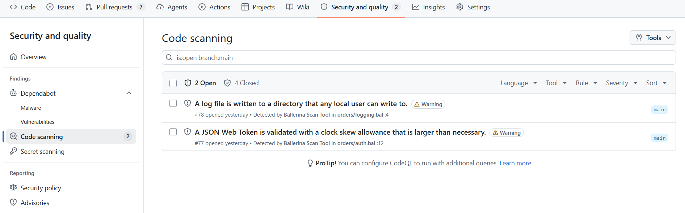
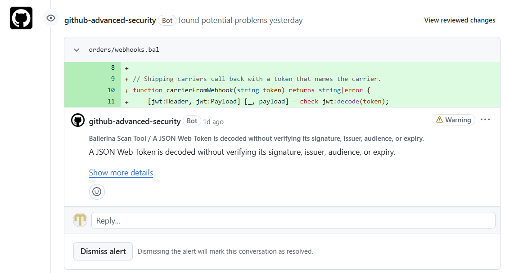
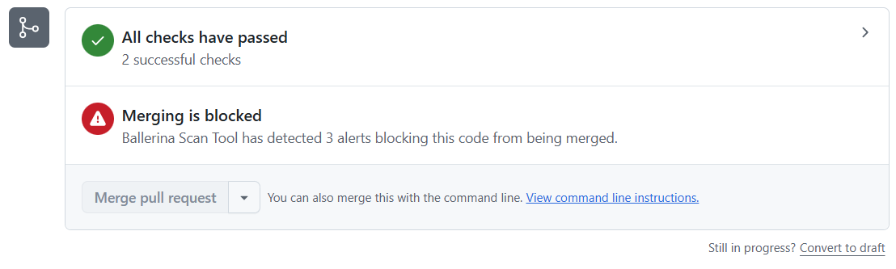
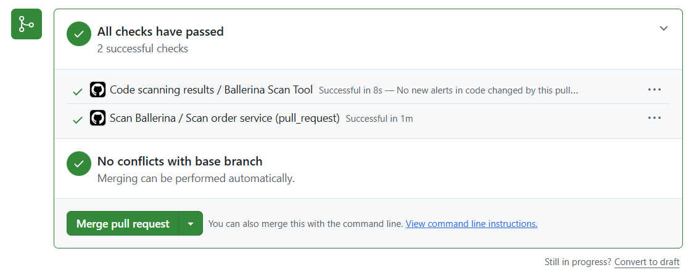
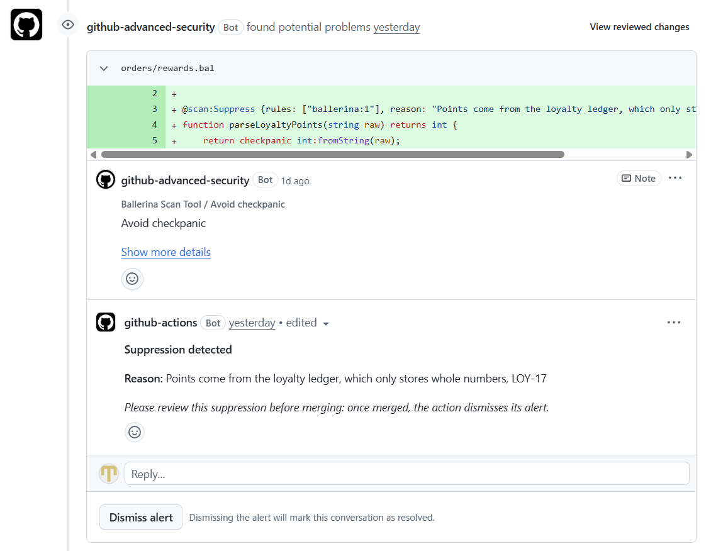
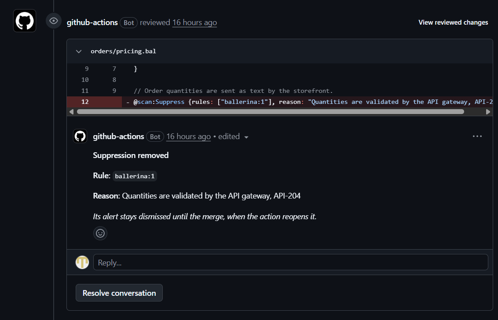
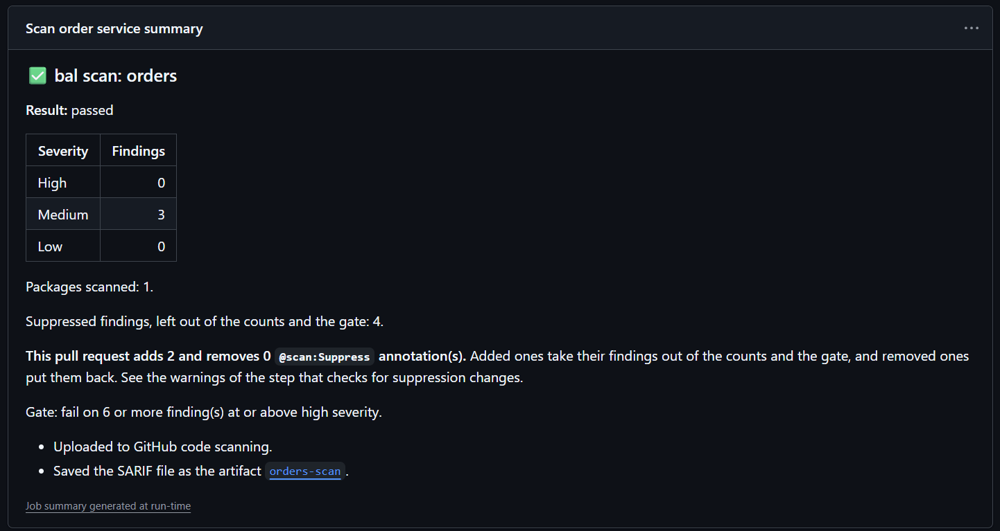
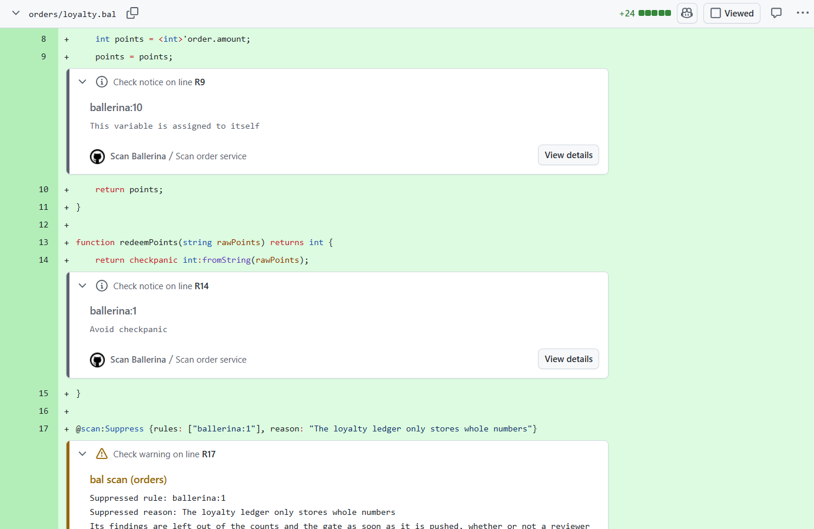

[](https://github.com/ballerina-platform/scan-ballerina/actions/workflows/test.yml)
[](https://github.com/ballerina-platform/scan-ballerina/blob/main/LICENSE)
[](https://github.com/ballerina-platform/scan-ballerina/issues)

# Scan Ballerina

GitHub Action that runs [`bal scan`](https://ballerina.io/learn/scan-tool/) on the Ballerina packages in a repository and sends the findings to the code scanning tool you use: GitHub code scanning, SonarQube, or any other platform that reads SARIF.

The action installs Ballerina and the scan tool, scans every package, and merges the reports into one SARIF 2.1.0 file with paths relative to the repository root. It leaves your files as they were: any file it changes during a scan is restored when that scan ends.

> [!NOTE]
> `v0` is a pre-release. It tracks the latest `v0.x.y` release; pin a release tag such as `v0.1.0`, or a commit SHA, for reproducible runs. The inputs are stable. Unless `tool-version` is set, the action uses the latest scan tool compatible with the installed Ballerina, so a new scan tool release is picked up without a new action release. Set `tool-version` to keep the rule IDs, severities and findings that `include-rules`, `exclude-rules`, `fail-on-severity` and `fail-on-count` depend on fixed.

## Usage

### GitHub code scanning

```yaml
jobs:
  scan:
    runs-on: ubuntu-latest
    permissions:
      contents: read
      security-events: write
      pull-requests: write # Only needed to comment suppressed findings on pull requests
      actions: read # Only needed in private repositories
    steps:
      - uses: actions/checkout@v4
      - uses: ballerina-platform/scan-ballerina@v0
        with:
          platforms: github-code-scanning
```

The findings appear as alerts under **Security and quality > Code scanning**, attributed to the Ballerina Scan Tool:



### SonarQube

The SonarQube server needs the [Ballerina language plugin](https://github.com/ballerina-platform/sonar-ballerina). The action installs the SonarScanner CLI, with its own Java runtime, and the scan tool's SonarQube platform plugin, and passes the server URL, token and project key to the scan:

```yaml
permissions:
  contents: read
  packages: read # The platform plugin is downloaded from GitHub Packages
steps:
  - uses: actions/checkout@v4
    with:
      fetch-depth: 0 # SonarQube needs history for blame and new-code detection
  - uses: ballerina-platform/scan-ballerina@v0
    with:
      platforms: sonarqube
      platform-config: |
        sonarqube:
          host-url: '${{ vars.SONAR_HOST_URL }}'
          token: '${{ secrets.SONAR_TOKEN }}'
          project-key: my-project
```

Settings left out of `platform-config` are read from the package's `sonar-project.properties`. See [Platform configuration](#platform-configuration).

### Any other SARIF consumer

```yaml
steps:
  - uses: actions/checkout@v4
  - id: scan
    uses: ballerina-platform/scan-ballerina@v0
  - run: ./upload-to-defectdojo.sh "${{ steps.scan.outputs.sarif-file }}"
```

### Save the SARIF file as an artifact

```yaml
- uses: ballerina-platform/scan-ballerina@v0
  with:
    artifacts: true
```

The action uploads the merged SARIF file as a workflow artifact named `<category>-<job>`, holding `<category>.sarif`. In a matrix job, the name also ends with the first 8 characters of a hash of the matrix values, as in `bal-scan-scan-1a2b3c4d`, so the jobs of a matrix do not collide. It is the same file as the `sarif-file` output, so saving it takes no extra `bal scan` run.

Artifact names are unique within a workflow run, so give each scan in a job its own `category`. Saving the artifact needs no extra permissions, so it also works in pull requests from forks.

### Gate on findings

```yaml
- uses: ballerina-platform/scan-ballerina@v0
  with:
    platforms: github-code-scanning
    fail-on-severity: medium # Fail on medium or high findings
    fail-on-count: 5         # ...when there are five or more of them
```

The findings are uploaded before the gate is applied, so they reach the platforms even when the gate fails.

`fail-on-severity` and `fail-on-count` work like the `bal scan` options of the same names, but the action applies them itself, to the findings of every scanned package together, after `exclude-paths`. `bal scan` gates each package on its own, and its gate, set by `[gate]` in `Scan.toml`, would fail the scan before the findings are uploaded, so the action turns it off with `--fail-on-severity=NONE`, and `bal scan` warns when it overrides a `[gate]` setting.

The gate counts every finding in the scanned packages, not only the ones a pull request introduces, so in a repository that already has findings it fails every pull request until they are fixed. To block only new findings, upload to code scanning and use a [code scanning merge protection rule](https://docs.github.com/en/repositories/configuring-branches-and-merges-in-your-repository/managing-rulesets/available-rules-for-rulesets#set-code-scanning-merge-protection) in a ruleset, which fails a pull request on the alerts it introduces.

In a pull request, code scanning comments on the lines that introduce new alerts:



With the merge protection rule, those alerts block the merge:



A pull request that introduces no alerts passes the code scanning check and can be merged, while a `fail-on-severity` gate still fails it on the findings already on the base branch:



### In-source suppressions

`bal scan` accepts a finding at the construct that contains it with the `@scan:Suppress` annotation of the `ballerina/scan` package, along with a reason:

```ballerina
import ballerina/scan;

@scan:Suppress {rules: ["ballerina/crypto:2"], reason: "Legacy hash kept for the migration window, SEC-1042"}
string hashed = check crypto:hashBcrypt(password, 4);
```

By default the action applies these suppressions:

- Suppressed findings are left out of the counts, `fail-on-severity`, `fail-on-count` and the annotations. The job summary and the `suppressed-count` output give their number. The SARIF file keeps them, each with a SARIF suppression, so the accepted risk stays auditable. SonarQube receives only the findings that are not suppressed.
- On the default branch, in `push`, `schedule` and `workflow_dispatch` runs, the action dismisses the code scanning alert of each suppressed finding as "won't fix" with the suppression's reason, and reopens it once the suppression is removed or the finding is gone. Other branches and events, including every pull request, leave the alerts as they are, so a finding a pull request newly suppresses is still a new alert until the merge.
- In `pull_request` and `pull_request_target` runs, the action warns at each `@scan:Suppress` annotation the pull request adds or removes, since an added one takes its findings out of the gate as soon as it is pushed. Unless `suppression-comments` is `false`, it also comments the suppression's reason on the pull request, which needs `pull-requests: write`. In `pull_request` runs for pull requests from forks and Dependabot, whose token cannot comment, the comments are skipped.

The reason of a suppressed finding on an added line is posted under code scanning's comment on its alert:



An annotation added or removed for a finding already on the default branch gets a comment at its line, naming its rules and its reason:



Set `suppressions: false` to report every finding, as if no suppression existed, for example in an audit job:

```yaml
- uses: ballerina-platform/scan-ballerina@v0
  with:
    platforms: github-code-scanning
    suppressions: false
```

See [In-source suppressions](docs/suppressions.md) for how the alerts are dismissed and reopened, the warnings on other branches, and the pull request comments.

### Job summary and annotations

```yaml
- uses: ballerina-platform/scan-ballerina@v0
  with:
    platforms: github-code-scanning
    annotations: true
```

The action writes the result, the counts by severity, the number of suppressed findings, the gate and where the findings were sent to the job summary. In a pull request, it also gives the number of `@scan:Suppress` annotations the pull request adds and removes:



With `annotations: true`, each counted finding is also shown as a file and line annotation on the run:



### Read the outputs after a failure

Steps after a failed step do not run unless they ask to, so read the outputs from a step with `if: always()` or `if: failure()`:

```yaml
- id: scan
  uses: ballerina-platform/scan-ballerina@v0
  with:
    platforms: github-code-scanning
    fail-on-severity: high
- if: always()
  env:
    RESULT: ${{ steps.scan.outputs.result }}
    HIGH: ${{ steps.scan.outputs.high-count }}
  run: echo "Result $RESULT, $HIGH high"
```

The action's last inner step runs even when an earlier one failed, so `result` is `error` after a failure before the gate.

## Inputs

| Input | Default | Description |
| --- | --- | --- |
| `ballerina-version` | compatible | Ballerina version to install, `2201.12.0` or later, and `2201.13.0` or later for `bal scan` `0.13.0` and later, or `latest` for the latest release. Empty uses the Ballerina already on the path if it can run the scan tool (the version `tool-version` needs, or `2201.13.0` or later when `tool-version` is empty), and installs the latest Ballerina otherwise. A version, or `latest`, is installed unless it is the one on the path. Pin a version for reproducible runs. See [Versions](#versions). |
| `tool-version` | latest compatible | `bal scan` tool version: `0.11.1` or later of `0.11.x`, for Ballerina `2201.12.x`, or `0.13.0` or later, or `latest` for the latest release. `0.12.x` is not supported. Empty uses the latest version compatible with the Ballerina version. A version, or `latest`, that does not support the Ballerina version fails the step. See [Scan tool 0.11](#scan-tool-011) for what `0.11.x` does not support. |
| `platforms` | empty | Comma separated platforms to send the findings to: `github-code-scanning`, `sonarqube`. Any other name fails the step. Empty produces the SARIF file only. |
| `paths` | `.` | Newline or comma separated paths to scan. Every package and workspace in these paths, including their subdirectories, is scanned, and their findings are merged into one SARIF file. A path that does not exist fails the step. |
| `exclude-paths` | empty | Newline or comma separated globs, relative to the repository root, for packages and files to leave out. A directory excludes everything below it. `*` stays within one directory and `**` crosses directories. |
| `exclude-tests` | `true` | Leave the test sources, in `tests/` and `modules/*/tests/`, out of the scan with `bal scan --exclude-tests`, so their findings and suppressions reach no platform, SonarQube included. `false` scans them. Overrides `[analysis] excludeTests` in `Scan.toml`, and `bal scan` warns when the two differ. |
| `category` | `bal-scan` | Name for this scan. Labels the uploaded findings, the job summary and messages. Use a different one for each scan in a job. |
| `include-rules` | empty | Comma separated rule IDs to report, such as `ballerina:1,ballerina/crypto:1`. Empty reports every rule. |
| `exclude-rules` | empty | Comma separated rule IDs to leave out, such as `ballerina:1,ballerina:10`. Cannot be combined with `include-rules`. |
| `fail-on-severity` | `none` | Fail when findings are at or above `low`, `medium` or `high`. `none` turns the gate off. |
| `fail-on-count` | `1` | Fail when this many findings, or more, are at or above `fail-on-severity`. A whole number of 1 or more. The action counts the findings of every scanned package together, after `exclude-paths` and the suppressions. |
| `annotations` | `false` | Show each counted finding as a file and line annotation. GitHub shows at most 10 annotations of each level per step and 50 per job, so beyond that the action annotates the first findings of each severity and warns how many it left out. |
| `job-summary` | `true` | Write the result and the high, medium and low counts to the job summary. |
| `artifacts` | `false` | Save the merged SARIF file as a workflow artifact named after `category` and the job. See [Save the SARIF file as an artifact](#save-the-sarif-file-as-an-artifact). |
| `suppressions` | `true` | Apply the in-source suppressions of `bal scan`. `true` leaves suppressed findings out of the counts, the gate and the annotations, and dismisses their code scanning alerts on the default branch. `false` reports every finding. See [In-source suppressions](#in-source-suppressions). |
| `suppression-comments` | `true` | In `pull_request` and `pull_request_target` runs, comment the reason of each suppressed finding on a line the pull request adds, as a reply to code scanning's comment on its alert, or at the line when there is none, and comment at each `@scan:Suppress` annotation the pull request adds or removes for findings already on the default branch. Needs `pull-requests: write`. See [In-source suppressions](#in-source-suppressions). |
| `platform-config` | empty | YAML mapping, keyed by platform, with the settings and credentials each selected platform needs. JSON is accepted. |
| `github-token` | `github.token` | Token for installing Ballerina, downloading the SonarQube platform plugin from GitHub Packages and uploading to code scanning. |

## Platform configuration

`platform-config` holds the settings of every selected platform. Each top-level key is a platform, and its value is that platform's settings. A key for a platform that is not supported fails the step, and a key for a platform not in `platforms` gets a warning and is ignored. A selected platform's settings must follow its schema, or the step fails, so a typo such as `tokn` is caught. `sonarqube` needs a `sonarqube:` key.

```yaml
platform-config: |
  sonarqube:
    host-url: https://sonar.example.com
    token: '${{ secrets.SONAR_TOKEN }}'
    packages:
      - path: services/orders
        project-key: orders
        project-name: Orders Service
      - path: services/payments
        host-url: https://sonar.payments.example.com
        token: '${{ secrets.PAYMENTS_SONAR_TOKEN }}'
        project-key: payments
```

`github-code-scanning` takes no settings. When it is selected, leave its key out or set it to `{}`.

> [!IMPORTANT]
> GitHub puts each `${{ }}` value into the YAML text before the action parses it, so put secrets in single quotes: a value with `:`, `#` or a leading quote or `{` would otherwise change the YAML or fail to parse. A secret that itself holds a single quote or a line break still does not fit. When `platform-config` does not parse, the action fails without printing the parser's error, which can quote the value.

### `sonarqube`

The fields at the platform level are the defaults for every scanned package. An item under `packages` can set any of them for one package, including its own `host-url` and `token`, so packages in one repository can report to different SonarQube servers or organizations.

| Field | Required | Description |
| --- | --- | --- |
| `plugin-path` | No | Platform plugin JAR, as a path relative to the repository root or an `https` URL. Overrides `path` in `Scan.toml`. Cannot be used with `plugin-version`. |
| `plugin-version` | No | Platform plugin version to download, `0.3.0` or later, or `latest` for the latest release. Overrides `path` in `Scan.toml`. A version this release knows, including the one `latest` resolves to, fails when it does not work with the installed scan tool. |
| `properties-file` | No | Properties file, relative to the repository root. Overrides `sonarProjectPropertiesPath` in `Scan.toml`. |
| `host-url` | Yes, unless set under `packages` or in the properties file | SonarQube server URL. Must be `https`. Overrides `sonar.host.url`. |
| `token` | Yes, unless set under `packages` | Token for submitting analyses. Pass it from a secret. |
| `project-key` | Yes, unless set under `packages` or in the properties file | Project key. Overrides `sonar.projectKey`. At the platform level, only when one package is scanned. |
| `project-name` | No | Project name. Overrides `sonar.projectName`. At the platform level, only when one package is scanned. |
| `packages` | No | Per-package settings. Each item has a `path`, relative to the repository root, and any of the fields above. Platform level only. |

Each setting of a package is resolved field by field: its `packages` item, then the platform level, then the package's `Scan.toml` and properties file. An item that sets `host-url` must also set `token`, so a token is never sent to a server it was not configured for. The platform plugin is published to GitHub Packages, so give the job `packages: read`, or set `plugin-path`. Workspaces are not supported with SonarQube yet: list their member packages in `paths` instead.

See [SonarQube](docs/sonarqube.md) for how each setting is resolved, workspaces, runs for forks and Dependabot, and the SonarScanner cache.

## `Scan.toml`

`bal scan` reads each package's settings from `Scan.toml` in the package root, or from the file that `[scan] configPath` in `Ballerina.toml` names. A workspace member without one uses the workspace's `Scan.toml`, which cannot have `[[platform]]` entries. `bal scan` runs a `[[platform]]` entry only when `--platforms` names it, so the SARIF scan reads the file as it is. For the SonarQube scan, the action points the `sonarqube` entry to the platform plugin, and then restores the file byte for byte.

When `configPath` is an `https` URL, the action downloads the file once, right after packages are found. For each scan, the action points `configPath` in `Ballerina.toml` to that copy in its work directory, changed for the SonarQube scan, then restores `Ballerina.toml` byte for byte. Only a `configPath = "..."` line under the `[scan]` table is changed. `bal scan` reads the copy, so it does not download the file again.

The action sets `--exclude-tests`, from `exclude-tests`, and turns off the `[gate]` of `Scan.toml`, as in [Gate on findings](#gate-on-findings). The other settings, such as `[rule]`, `[analysis]` and `[suppression]`, apply as `bal scan` reads them. `include-rules` adds to `include` in `[rule]` and `exclude-rules` to `exclude`, and neither can be used when `Scan.toml` sets the other list.

`bal scan` scans only packages whose dependencies are locked in `Dependencies.toml`, which `bal build` writes, and fails a package without it. Commit `Dependencies.toml` with each package, as Ballerina recommends, or run `bal build` in a step before the action. The step then fails with the error of `bal scan`, in the annotations and the job summary.

Whatever platforms are selected, the step fails after packages are found, before the tools are downloaded, when a package:

- sets `configPath` to an `http` or other non-`https` URL. The scan tool loads the platform plugin JAR of each `[[platform]]` entry, so the file must not be changed in transit.
- sets `configPath` to an `https` URL that cannot be downloaded, or that is not valid TOML.
- sets `configPath` in a form the action cannot change, such as an inline table. Write it as a `configPath = "..."` line under `[scan]`.
- sets `configPath` to a file that does not exist, which `bal scan` would try to download as a URL.
- has a `[scan]` table without `configPath`, which `bal scan` rejects.

## Outputs

| Output | Description |
| --- | --- |
| `result` | `passed` or `failed` from the gate, `skipped` when no package was found, or `error` when the step failed before the gate. |
| `sarif-file` | The merged, normalized SARIF file, with the suppressed findings. Empty when no package was found or a scan failed. |
| `high-count`, `medium-count`, `low-count`, `total-count` | Counted findings, after the test and path filters, without the suppressed ones. `total-count` does not include `INFO` findings. `0` when no package was found, and empty when the findings were not counted, such as when a scan failed. |
| `suppressed-count` | Suppressed findings, left out of the other counts. `INFO` findings are not counted. `0` when no package was found or `suppressions` is `false`, and empty when the findings were not counted. |
| `packages-scanned` | Number of packages scanned, with each member of a workspace counted. Set once every package was scanned: `0` when no package was found, and empty when a scan failed or did not run. |
| `uploads` | JSON object with one entry per platform the findings were sent to, and an `artifact` entry when the SARIF file was saved as an artifact, such as `{"github-code-scanning": {"sarif-id": "…"}, "sonarqube": [{"package": "…", "project-key": "…", "dashboard-url": "…", "task-id": "…"}], "artifact": {"name": "…", "id": "…", "url": "…"}}`. `{}` when nothing was uploaded. |

Read a value from `uploads` with `fromJSON(steps.scan.outputs.uploads)['github-code-scanning']['sarif-id']`.

## Severity

| Ballerina severity | SARIF `level` | Action severity |
| --- | --- | --- |
| `BLOCKER`, `HIGH` | `error` | `high` |
| `MEDIUM` | `warning` | `medium` |
| `LOW` | `note` | `low` |
| `INFO` | `none` | Not counted |

A result without a `level` takes its rule's default level, and `warning` when the rule has none either.

## Versions

Ballerina and the scan tool are resolved together, and then the SonarQube platform plugin for the scan tool. Each must be a supported version: Ballerina `2201.12.0` or later, plugin `0.3.0` or later, and `bal scan` from one of two lines:

- **`0.13.0` and later**, for Ballerina `2201.13.0` and later.
- **`0.11.1` and later of `0.11.x`**, for Ballerina `2201.12.x`, which have the in-source suppressions, `--exclude-tests` and platform handling of `0.13.0`. See [Scan tool 0.11](#scan-tool-011).

`0.12.x` and `0.11.0` have neither suppressions nor `--exclude-tests`, so they are not supported.

- **A version, or `latest`,** is used as given. `latest` is the latest release, whatever the other versions are. A pair that does not work together fails before anything is installed.
- **Empty** is resolved to a version that works with the others:

| `ballerina-version` | `tool-version` | Result |
| --- | --- | --- |
| version or `latest` | version or `latest` | Both as given, if they work together. |
| version or `latest` | empty | That Ballerina, and the latest scan tool compatible with it. |
| empty | version or `latest` | The Ballerina on the path if it can run that scan tool, otherwise the latest Ballerina. |
| empty | empty | The Ballerina on the path if it is `2201.13.0` or later, which runs `bal scan` `0.13.0` and later, otherwise the latest Ballerina, and the latest scan tool compatible with it. To keep a Ballerina `2201.12.x` on the path, set `tool-version` to `0.11.1` or a later `0.11.x` version. |

When Ballerina Central picks a scan tool the action does not support, such as `0.11.0` for Ballerina `2201.12.x` before `0.11.1` is published, the step fails before the scan tool is installed.

An empty `plugin-version`, with no `plugin-path` or `Scan.toml` path, is the newest plugin this release knows to work with the installed scan tool. Plugin `0.3.0` works with both supported lines, `0.11.x` and `0.13.x`.

## Scan tool 0.11

`bal scan` `0.11.1` and later of `0.11.x`, the scan tool for Ballerina `2201.12.x`, have the in-source suppressions, `--exclude-tests`, gate and platform handling of `0.13.0`, and are supported with these differences:

- **Severity:** rules have no severity, so the level follows the rule kind: a bug is `error` (`high`), a vulnerability is `warning` (`medium`) and a code smell is `note` (`low`). The rule kind, which `0.11.x` leaves out of the SARIF file, is taken from that level, so vulnerabilities are still tagged `security` in code scanning.
- **Messages and help:** each finding's message is its rule's title, and rules have no CWE, OWASP or tag details.
- **Workspaces:** Ballerina `2201.12.x` has no workspaces, and `0.11.x` cannot scan them, so a workspace in `paths` fails the step before anything is scanned, with an error that names the Ballerina or scan tool version. Use Ballerina `2201.13.0` or later with `bal scan` `0.13.0` or later, or leave the workspace out with `exclude-paths`.

## Failure behaviour

Findings never fail the step unless you set `fail-on-severity`. Problems with the setup or the scan do.

| Situation | Result |
| --- | --- |
| Invalid input, or a path that does not exist | Fails before packages are searched or anything but `yq` is downloaded |
| Missing or invalid SonarQube settings, missing or duplicate project keys, a `packages` item that matches no package or repeats a path, or a workspace with `sonarqube` | Fails after packages are found, before anything is downloaded |
| No package found | Passes with a warning, result `skipped` |
| A workspace with Ballerina older than `2201.13.0` or `bal scan` `0.11.x` | Fails before the tools are installed, or, when Ballerina Central cannot resolve a version, before any package is scanned |
| A `tool-version` that is not supported, such as `0.12.0`, or a Ballerina for which Ballerina Central picks one | Fails before the scan tool is installed |
| A package without `Dependencies.toml` | `bal scan` fails it, so it fails as below, with the error of `bal scan` in the annotations and the job summary. See [`Scan.toml`](#scantoml) |
| `bal scan` fails for a package | The other packages are still scanned, then the step fails without a SARIF file |
| SonarQube is unreachable or rejects the analysis of a package | The other packages are still scanned, the SARIF file is produced and sent to the other platforms, then the step fails with result `error` |
| A package reads its `Scan.toml` from a non-`https` URL, an `https` URL that cannot be downloaded, or a missing file, or has a `[scan]` table without `configPath`, with any platforms | Fails after packages are found, before the tools are downloaded. See [`Scan.toml`](#scantoml) |
| Upload to code scanning fails | Fails, after the SARIF file is written. In a run for a pull request from a fork, or triggered by Dependabot, on any event other than `pull_request`, `pull_request_target` and `workflow_run`, passes with a warning instead |
| Dismissing or reopening the code scanning alerts of suppressed findings fails | Passes with a warning, after the upload |
| Restoring or saving the SonarScanner files in the Actions cache fails | Passes, and downloads them as without the cache |
| Saving the artifact fails, such as when another scan in the run used the same `category` | Fails, after the findings are uploaded |
| Findings over the gate | Fails, after the SARIF file is written and uploaded |
| Fork or Dependabot pull request with an empty SonarQube token | Skips SonarQube with a warning, and still produces the SARIF file |
| `pull_request` run for a fork or Dependabot pull request, with `github-code-scanning` | Uploads the SARIF file, since code scanning accepts uploads from `pull_request` runs with a read-only token |
| Fork run on another pull request event, such as `pull_request_review`, or Dependabot run on another event, such as `push`, with `github-code-scanning` | Uploads the SARIF file when the token can write security events. Otherwise skips the upload with a warning, and keeps the SARIF file as the `sarif-file` output and in the artifact, when `artifacts` is `true` |

## How it works

The action is a composite action. Its logic is in the shell and `jq` scripts in [`scripts/`](scripts), which read their inputs from environment variables and can be run locally. It runs on GitHub-hosted Ubuntu, macOS and Windows runners. A self-hosted runner needs bash, `jq`, `curl`, `awk`, `sha256sum` or `shasum`, and `git` 2.13 or later, and for SonarQube also `unzip`.

See [How it works](docs/how-it-works.md) for each step, how `Scan.toml` and `Ballerina.toml` are edited and restored, and the SonarScanner cache.

## Security

- `setup-ballerina`, `upload-sarif`, `upload-artifact` and `actions/cache` are pinned by full commit SHA, which Dependabot keeps up to date. The scan tool is the latest version compatible with the Ballerina version unless `tool-version` pins one. `yq`, when the runner has none, the SonarQube platform plugin and the SonarScanner CLI are downloaded at versions this release knows, and their SHA-256 is verified. A `plugin-version` this release has no checksum for, and a plugin given as an `https` URL, are downloaded with a warning, since they cannot be verified.
- The SonarScanner CLI zip is checked against its SHA-256 on download and on every restore from the Actions cache. The cache of the servers' analyzers is saved only from trusted events. See [SonarScanner cache](docs/how-it-works.md#sonarscanner-cache).
- Inputs reach the scripts as environment variables and are never interpolated into scripts.
- Every `token` in `platform-config`, at the platform level and under each `packages` item, is masked, and `platform-config` is never printed. Each package's token goes to that package's scan only.
- The action needs only `contents: read`. With `github-code-scanning`, it also needs `security-events: write`, which also lets it dismiss and reopen alerts on the default branch, and `actions: read` in private repositories. Runs for pull requests from forks never get `security-events: write`, but code scanning still accepts their uploads from `pull_request` runs. See [Failure behaviour](#failure-behaviour). With `sonarqube` and the default plugin, it also needs `packages: read`.

## License

This project is licensed under the Apache License 2.0. See [LICENSE](LICENSE).
