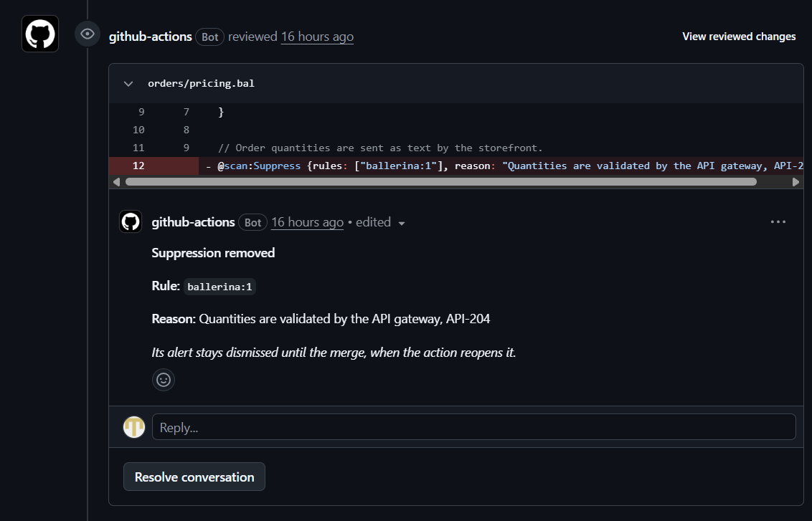
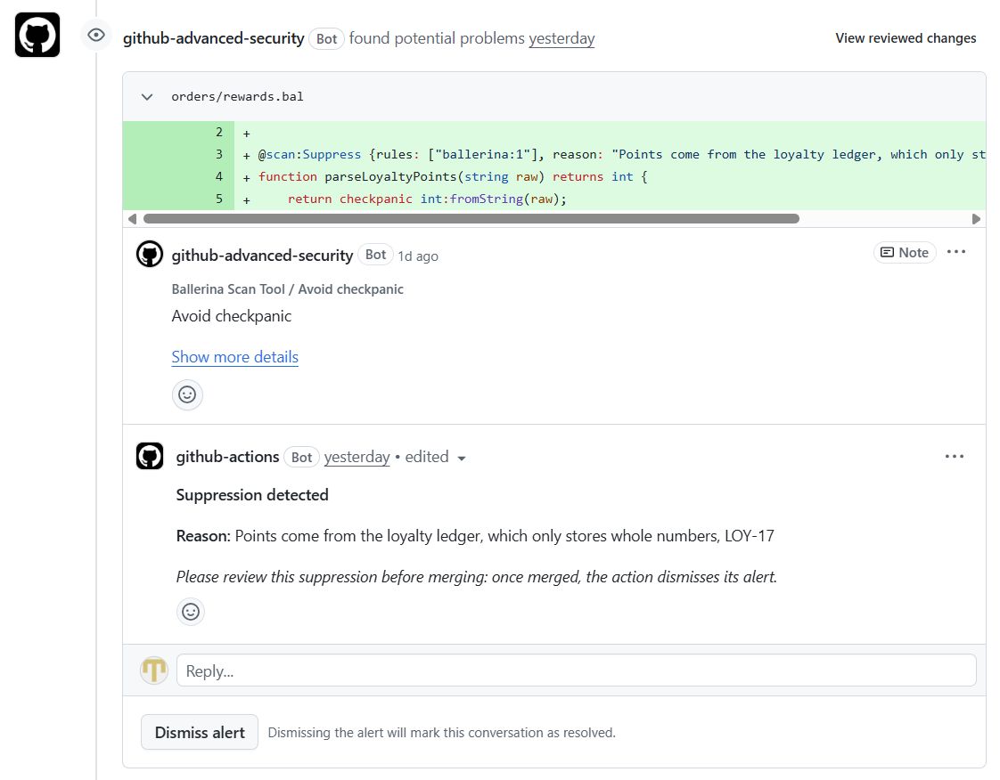

# In-source suppressions

`bal scan` accepts a finding at the construct that contains it with the `@scan:Suppress` annotation of the `ballerina/scan` package, along with a reason:

```ballerina
import ballerina/scan;

@scan:Suppress {rules: ["ballerina/crypto:2"], reason: "Legacy hash kept for the migration window, SEC-1042"}
string hashed = check crypto:hashBcrypt(password, 4);
```

The action applies these suppressions unless `suppressions` is `false`. This page describes what it does with them on each kind of run. See the [README](../README.md#in-source-suppressions) for a summary.

## Counts, gate and SARIF file

- Suppressed findings are left out of the counts, `fail-on-severity`, `fail-on-count` and the annotations. The job summary and the `suppressed-count` output give their number.
- The SARIF file keeps them, each with a SARIF suppression, so the accepted risk stays auditable. Every result of the merged run gets a `suppressions` array, empty when the finding is not suppressed, as SARIF requires.
- SonarQube receives only the findings that are not suppressed.

## Code scanning alerts on the default branch

Code scanning ignores SARIF suppressions, so on the default branch, in `push`, `schedule` and `workflow_dispatch` runs, the action dismisses the alert of each suppressed finding after the upload, as "won't fix" with the suppression's reason as the comment.

- An alert dismissed by hand whose finding is then suppressed is taken over: it keeps its reason, and its comment becomes the suppression's, as does that of an alert whose suppression reason changed.
- The action reopens an alert it dismissed once the finding is reported again without a suppression, and once the finding is gone, such as when the code is fixed or deleted, so that code scanning sets it to fixed rather than leaving it dismissed.
- It leaves the other alerts dismissed by hand alone.
- It first waits up to 3 minutes for code scanning to process the upload, so that it changes the current alerts. When the alerts cannot be listed or changed, or the upload was not processed in time, the job summary says so, and the next run catches up.

## Other branches and events

Dismissing changes the alerts of the whole repository, so on other branches and events, including every pull request, whether from a branch of the repository or a fork, and `pull_request_target` and `workflow_run`, which can scan pull request code, suppressed findings are uploaded like any other and their alerts are not dismissed. A finding a pull request newly suppresses is then a new alert, which a ruleset that blocks new code scanning alerts holds until someone allowed to dismiss alerts dismisses it.

Code scanning never reopens a dismissed alert and shows no new alert for a finding that matches one. So on other branches the action warns, at the finding and in the job summary, when a finding is reported without a suppression but matches a dismissed alert:

- one it dismissed whose suppression the change removes, which it reopens once the change is merged, unless the pull request removes the annotation itself, which is warned about at the annotation instead.
- one dismissed by anyone whose finding the default branch no longer has, such as code reintroduced after it was fixed.

A finding a pull request newly suppresses that is already on the default branch keeps its open alert, so code scanning shows nothing for it either.

## Pull requests

### Added and removed annotations

In `pull_request` and `pull_request_target` runs, the action reads the `@scan:Suppress` annotations the pull request adds and removes from the diff with its base commit, also in runs for forks and Dependabot. It shows one warning at each added annotation, naming its rules and its reason, since its findings are left out of the counts and the gate as soon as it is pushed, whether or not a reviewer accepts it, and one at each removed one, since its findings are counted again and their alerts stay dismissed until the merge. The job summary gives their number.

Unless `pr-comment` is `false`, an annotation added or removed for findings already on the default branch, which code scanning shows nothing for, also gets a review comment at its line, on the deleted line for a removed one, naming its rules and its reason:



### Suppressed findings on added lines

Unless `pr-comment` is `false`, the action comments the reason of each suppressed finding on a line the pull request adds. Code scanning comments each new alert at its line, so the action waits up to 2 minutes for that comment and posts the suppression's reason as a reply in its thread, right under the finding's message:



A finding that code scanning does not comment in time, or at all, such as one matching an alert dismissed before, or a run that did not upload to code scanning, gets a comment of its own at the line, with the finding's severity, rule and message and the reason.

### Comment updates and permissions

A comment already there is edited rather than repeated. One whose finding is no longer suppressed, or whose change the pull request no longer makes, says so.

The comments need the `pull-requests: write` permission, and a failure only warns. Runs for pull requests from forks and Dependabot have a read-only token, so they cannot comment. Set `pr-comment: false` to turn the comments off.

## Turning suppressions off

```yaml
- uses: ballerina-platform/scan-ballerina@v0
  with:
    platforms: github-code-scanning
    suppressions: false # Report every finding, as if no suppression existed
```

`suppressions: false` passes `--ignore-suppressions` to both `bal scan` runs, so suppressed findings are counted, annotated and uploaded like any other. The action then leaves the code scanning alerts as they are, so such a run, such as an audit job, does not reopen the alerts it dismissed for suppressions.

`[suppression] enabled = false` in a package's `Scan.toml` still turns suppressions off for that package when `suppressions` is `true`. With `exclude-tests: true`, the default, the suppressions in test sources are not reported either, since `bal scan` leaves the tests out.
